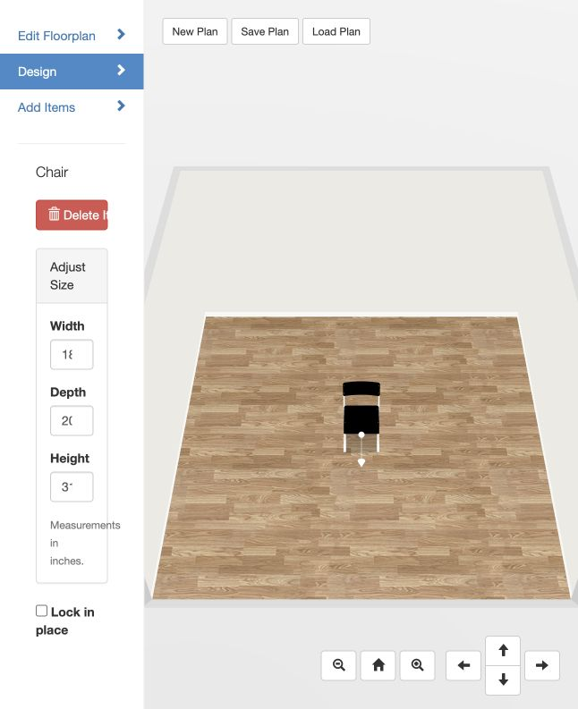

# 3D Home

3D Home is a Blueprint3D interior-design prototype. It combines the original 2D floorplanner and Three.js room editor with named GLB furniture assets, floor and wall materials, and an AI Studio for image-to-3D jobs.

The current image-to-3D path uses a local worker and the authenticated Kaggle CLI by default. Kaggle runs Hunyuan3D on an ephemeral NVIDIA GPU, so the Mac does not need to store the multi-gigabyte model or run CUDA. A native Apple MLX backend remains available as an optional local experiment.



## Run the app locally

Requirements: Node.js/npm, Python 3, and a browser.

From the repository root:

```sh
npm install
npm run build
npm start
```

Open [http://127.0.0.1:8000](http://127.0.0.1:8000). The static server serves the `example/` directory. `npm run build` compiles the TypeScript core and copies the browser bundle.

The app has three main editing areas:

- **Edit Floorplan** edits walls and room geometry in 2D.
- **Design** edits the 3D scene, floor materials, and wall materials.
- **Add Items** inserts furniture and other catalog assets.

## Run the AI worker

The browser posts AI Studio jobs to `http://127.0.0.1:8001/api/jobs`. Start the worker in a second terminal:

```sh
npm run start:ai
```

The worker binds to localhost only. Check it with:

```sh
curl http://127.0.0.1:8001/health
```

The default response identifies the active backend and Kaggle kernel. Keep both terminals running while using Image → 3D asset in the UI.

## Image → 3D with Kaggle

The default backend is Kaggle. It uses the account and private resources configured in `kaggle/hunyuan3d-gpu/kernel-metadata.json`:

- Dataset: `sparshnagpal/furniture-image`
- Kernel: `sparshnagpal/hunyuan3d-gpu-smoke-test`
- Machine: NVIDIA Tesla T4
- Model: Hunyuan3D-2mini shape plus texture pipeline

Authenticate once on the machine running the worker:

```sh
kaggle auth login
kaggle kernels status sparshnagpal/hunyuan3d-gpu-smoke-test
```

When an image is submitted in **AI Studio**, the worker:

1. Saves the upload as a job input.
2. Versions the private Kaggle dataset with the uploaded image.
3. Pushes the kernel with `kaggle kernels push`.
4. Polls the kernel status while the UI displays stage and elapsed time.
5. Downloads the GLB output with `kaggle kernels output`.
6. Copies the generated asset to `example/models/ai/<asset-name>.glb`.

The worker uses a single shared Kaggle dataset and kernel. Run one generation at a time; a later job can replace the dataset version used by an earlier job. Kaggle credentials stay in the local Kaggle credential store and are never sent to the browser.

The kernel source is [kaggle/hunyuan3d-gpu/run.py](kaggle/hunyuan3d-gpu/run.py). It removes the source background, generates the shape, runs the texture stage, and writes a GLB. The generated gray sofa was produced through this path and is included in the catalog.

## Optional local MLX backend

The local backend is useful when the Hunyuan3D-MLX checkpoint is already present on an Apple Silicon machine. It is not required for the default Kaggle flow and its model files are intentionally ignored by Git.

```sh
AI_BACKEND=mlx npm run start:ai
```

The MLX checkout and environment are under the local `hunyuan3d-mlx/` directory. From `hunyuan3d-mlx/python/shape`:

```sh
uv sync
./.venv/bin/python scripts/dl_modelscope.py
```

The checkpoint is several gigabytes and the download is resumable. The local worker uses quantized Hunyuan3D-2mini inference and writes shape GLBs. The Kaggle path is preferred for this project because it avoids local storage and GPU memory requirements.

## Current assets

These assets are checked into the app and appear in **Add Items**:

| Asset | App file | Source |
| --- | --- | --- |
| AI Sofa - Blue Fabric | `example/models/ai/blue-fabric-sofa.glb` | textured furniture GLB |
| AI Sofa - Gray (Kaggle) | `example/models/ai/gray_sofa.glb` | generated from `gray_sofa.webp` through Kaggle |
| Nesting Tables - Marble & Gold | `example/models/ai/nesting-tables.glb` | generated through Kaggle |

Catalog thumbnails are in `example/models/thumbnails/`. Furniture metadata and names are in `example/js/items.js`. GLB loading, material extraction, bounding boxes, and initial scaling are implemented in `src/model/scene.ts` and `src/items/item.ts`.

The example also includes:

- White marble and light wood floors.
- Adjustable floor texture scale.
- White, warm white, sage, and pale blue wall paints.
- Existing Blueprint3D furniture, doors, and windows.
- A hand-authored two-room import fixture at `example/ai-samples/two-room.blueprint3d`.

## AI Studio workflows

AI Studio currently exposes three workflows:

- **Image → 3D asset (GLB)** is connected to the Kaggle worker.
- **Image → floorplan** has the upload and job UX; the geometry extraction worker still needs to be connected.
- **Image → room design** has the upload and job UX; asset retrieval and scene placement are the next backend stage.

The browser job contract is documented in [docs/AI_PIPELINE.md](docs/AI_PIPELINE.md). The worker accepts `POST /api/jobs` with `image` and `workflow`, then the UI polls `GET /api/jobs/:id` for `status`, `stage`, `stageIndex`, `progress`, and `message`.

## Troubleshooting

**The AI Studio says the worker cannot connect**

Make sure `npm run start:ai` is running and check `curl http://127.0.0.1:8001/health`.

**Kaggle says authentication or permission failed**

Run `kaggle auth login` again and confirm the authenticated account can access the private dataset and kernel named in `kernel-metadata.json`.

**A job stays running**

Check `kaggle kernels status sparshnagpal/hunyuan3d-gpu-smoke-test` and the Kaggle kernel logs. The worker is intentionally single-job because the dataset and kernel are shared.

**The new catalog item does not appear**

Reload the app with a cache-busting query, then open **Add Items**. Confirm the GLB exists under `example/models/ai/` and that its entry is present in `example/js/items.js`.

## Repository boundaries

Committed files include application code, documentation, Kaggle scripts, thumbnails, source images needed for the smoke pipeline, and the current generated GLBs. The repository ignores Kaggle outputs, job scratch directories, local MLX checkouts, virtual environments, model weights, and credentials. These files are large or machine-specific and can be regenerated.

More detailed notes are in [docs/AI-INTEGRATION.md](docs/AI-INTEGRATION.md), [docs/FREE-LOCAL-MODELS.md](docs/FREE-LOCAL-MODELS.md), and [ai-worker/README.md](ai-worker/README.md).

## License

The original Blueprint3D project is distributed under the terms in [LICENSE.txt](LICENSE.txt). Model and generated-asset licenses must be checked separately before redistribution.
